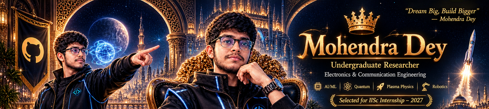
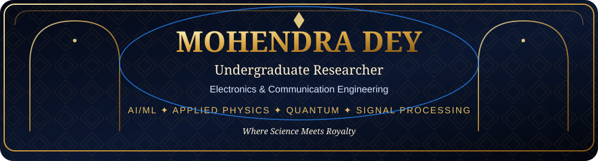
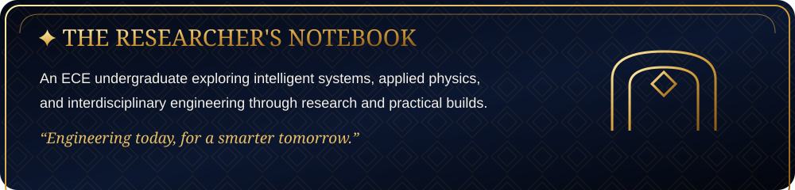
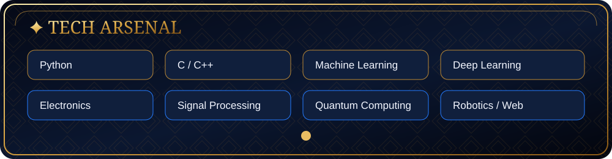
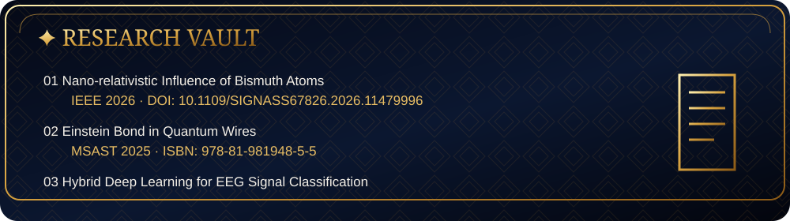
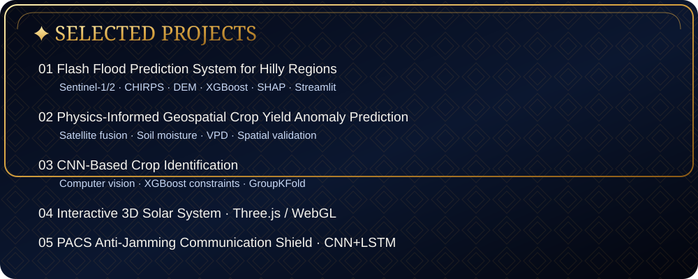
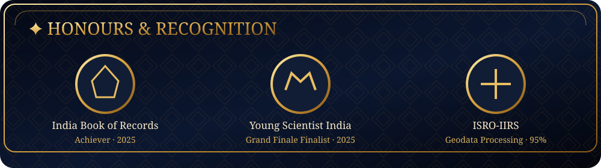
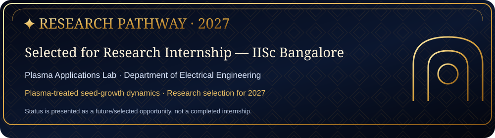

# ✦ MOHENDRA DEY ✦
### Undergraduate Researcher · Electronics & Communication Engineering

**AI/ML · Applied Physics · Quantum Technologies · Signal Processing · Robotics**

*Where Science Meets Royalty.*

---

## 🏛️ About the Researcher

I am an Electronics & Communication Engineering undergraduate at **JIS College of Engineering**, interested in building practical systems at the intersection of intelligent computing, electronics, and applied physics. My work spans geospatial machine learning, signal processing, scientific computing, and experimental research.

> *Engineering today, for a smarter tomorrow.*

## ⚙️ Tech Arsenal

**Working areas:** Python, C/C++, machine learning, deep learning, data science, Google Earth Engine, geospatial analysis, electronics, signal processing, quantum computing concepts, robotics, Three.js, WebGL, FastAPI, and Streamlit.

## 📚 Research & Publications

1. **“Nano-relativistic Influence of Bismuth (Bi) Atoms in Nano-electronic Donor-Doped Technology”** — IEEE 2026. [DOI](https://doi.org/10.1109/SIGNASS67826.2026.11479996)
2. **“Simplified Theory and Direction for Experimental Resolution of the Einstein Bond in Quantum Wires”** — MSAST 2025. ISBN: `978-81-981948-5-5`.
3. **“Hybrid Deep Learning Models for Real-Time EEG Signal Classification in Non-Invasive BCI-Controlled Assistive Robotics”** — IJIRT.

## 🧪 Selected Projects

| Project | Focus |
|---|---|
| [Flash Flood Prediction System](https://github.com/MOHENDRA-3850) | Multi-source satellite, rainfall and terrain data; explainable ML risk mapping |
| [Physics-Informed Crop Yield Anomaly Prediction](https://github.com/MOHENDRA-3850) | Remote sensing, hydrological variables and spatial validation |
| [CNN-Based Crop Identification](https://github.com/MOHENDRA-3850/CNN-Based-Crop-Identification-for-District-wise-Crop-Yield-Estimation) | Crop identification and district-wise yield estimation |
| NASA-Grade Interactive 3D Solar System | Three.js, WebGL, orbital mechanics and procedural textures |
| PACS — Portable Anti-Jamming Communication Shield | CNN+LSTM, beamforming, FHSS and mesh networking |
| ML Model API Deployment | REST API deployment using FastAPI |

## 🏅 Achievements & Recognition

- **India Book of Records Achiever (2025):** recognition for conceptualising and publishing original scientific theories.
- **Young Scientist India, 11th Edition (2025):** Grand Finale Finalist.
- **ISRO-IIRS:** Geodata Processing using Python & ML — 95% as listed in the supplied CV.
- **IEEE 2026:** research publication.

## 🔭 IISc Bangalore · 2027

**Selected for 2027 — Research Internship, Plasma Applications Lab, Department of Electrical Engineering, Indian Institute of Science (IISc), Bengaluru.**

Research direction: plasma-treated seed-growth dynamics, germination behaviour, and plant morphology. This is presented as a 2027 selection/opportunity, not as a completed internship.

## 🎓 Education

**B.Tech — Electronics & Communication Engineering**  
JIS College of Engineering · 2025–2029  
First-semester SGPA listed in CV: **8.31**

## 📊 GitHub

The repository intentionally does not display invented repository, follower, commit, or contribution counts. GitHub activity can be viewed directly on the profile: [github.com/MOHENDRA-3850](https://github.com/MOHENDRA-3850).

## 🤝 Let’s Connect

- **Email:** [mohendradey2021@gmail.com](mailto:mohendradey2021@gmail.com)
- **LinkedIn:** [linkedin.com/in/mohendradey](https://www.linkedin.com/in/mohendradey)
- **GitHub:** [github.com/MOHENDRA-3850](https://github.com/MOHENDRA-3850)

*Dream Big · Research Deep · Build Boldly*

**MOHENDRA DEY**  
*Engineer · Researcher · Creator*

